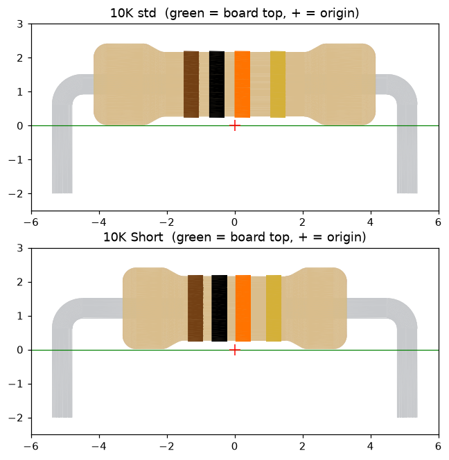
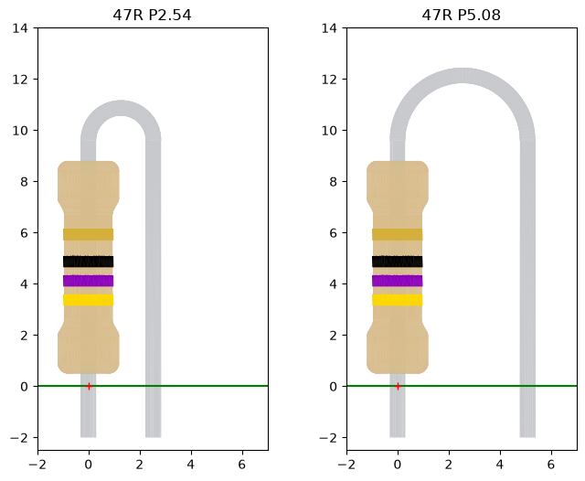

# Resistor 3D models: colour-banded axial and hairpin resistors for KiCad

These are original, script-generated 3D models (STEP) of ¼ W carbon-film through-hole resistors. Every value has the correct colour bands, so board renders, assembly manuals and kit instructions show the real part.
By Kevin Murphy / [Somerled.Design](https://somerled.design). Licensed under CERN-OHL-S-2.0 (see `LICENSE.txt`).

## What's included (680 STEP files)
| Set | Files | Name pattern |
|---|---|---|
| Axial, standard body (8.3 mm) | 170 | `Res40-Axial 0_25W-<value>.step` |
| Axial, short body (6.6 mm) | 170 | `Res40-Axial Short 0_25W-<value>.step` |
| Hairpin (vertical), 2.54 mm / 0.1 in pitch | 170 | `Res Axial Hairpin P254 0_25W-<value>.step` |
| Hairpin (vertical), 5.08 mm / 0.2 in pitch | 170 | `Res Axial Hairpin P508 0_25W-<value>.step` |

Values: the full E24 series from 1R to 10M, plus 0R (a single black band).
Value names are written 1R, 4R7, 47R, 470R, 4K7, 47K, 470K, 4M7, 10M. Under 10 Ω the multiplier band is gold (×0.1).
Bands: digit 1, digit 2, multiplier, and gold (5 %) tolerance.

## Geometry and origin
* Axial: the origin is midway between the pins on the board surface. The body lies along X, with pins at x = ±5.08 mm (10.16 mm / 400 mil pitch). The leads are Ø0.6 mm and go 2.0 mm below the board, and the body is Ø2.4 mm.
* Hairpin: pin 1 is at the origin under the upright body and pin 2 is at +X by the pitch. The top lead bends over in a true semicircle. This matches KiCad's `R_Axial_..._Vertical` footprints.
* All parts use per-part colours (AP214) and look right in KiCad's 3D viewer and raytracer.

## ⅛ W parts
Everything is modelled at ¼ W size. For ⅛ W, set **scale 0.5** in the footprint's 3D model settings, and offset it to suit the footprint's pitch. At 0.5 scale, the Short axial body is about 3.3 × 1.2 mm.

## Using them in KiCad
1. Copy or clone the folder somewhere, e.g. `~/KiCad/3dmodels/resistors`.
2. In Preferences → Configure Paths, point a variable at it (e.g. `KICAD_USER_3D_MODEL_DIR`).
3. In each footprint's Properties → 3D Models, add `${KICAD_USER_3D_MODEL_DIR}/resistors/Res40-Axial 0_25W-10K.step` (or another value).

## Regenerate or customise
    pip install cadquery matplotlib
    python gen_resistors.py <outdir>          # axial, standard + Short
    python gen_hairpin.py <outdir>            # hairpin P254 + P508
    python render_preview.py                  # previews/*.png
The geometry constants (body length, diameters, lead size, pitch, colours) are at the top of `gen_resistors.py`.
